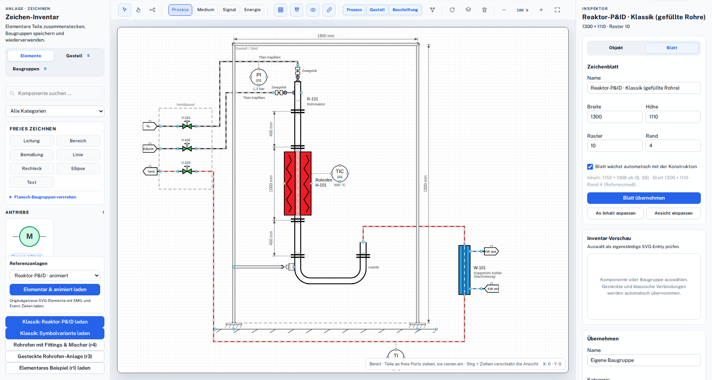
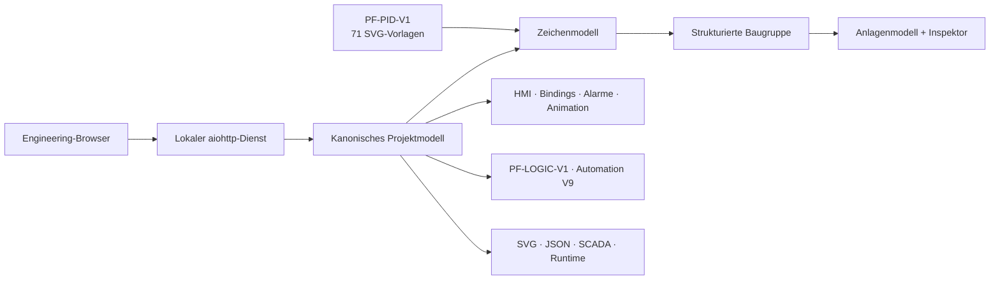

# Plant Factory

<p align="center">
  
</p>

<p align="center">
  <strong>Prozessanlagen aus wiederverwendbaren SVG-Bauteilen konstruieren, mit Automatisierungssemantik verbinden und konsistent in HMI/SCADA- und Runtime-Exporte überführen.</strong>
</p>

<p align="center">
  <a href="README.md">English</a> ·
  <a href="docs/ARCHITECTURE.md">Architektur</a> ·
  <a href="docs/v64_r6/TEST_UND_FREIGABE.md">Freigabenachweis</a> ·
  <a href="SECURITY.md">Security</a>
</p>

## Warum Plant Factory existiert

Klassische Engineering-Werkzeuge trennen häufig die originalgetreue Zeichnung
vom ausführbaren Anlagenmodell. Plant Factory hält beides zusammen: Eine
Zeichenbaugruppe wird als strukturierte Anlage eingesetzt, jedes Gerät bleibt
einzeln auswählbar und für Details, I/O, HMI, Zustände und Runtime-Zuordnungen
erreichbar. Beschriftungen, Maße und Bereiche bleiben als passive
Zeichnungsebene erhalten.

`64_r6` ist der aktuelle additive Stand einer über Jahre entwickelten
Engineering-Linie. PF-PID-V1, PF-LOGIC-V1, Automation V9 und Cross V8 bleiben
kompatibel erhalten.

## Kernnutzen

- P&IDs und Anlagenbilder aus 71 deterministisch geprüften Vorlagen aufbauen.
- Teile über semantische Prozess-, Medien-, Signal- und Energieports verbinden.
- Baugruppen wiederverwenden, ohne Geräteidentität und Editierbarkeit zu verlieren.
- Sensoren, Aktoren, HMI-Widgets, Alarme und Ereignisanimationen explizit binden.
- Typisierte Schaltlogik mit IEC-Timern/Zählern modellieren.
- SVG, JSON, HMI/SCADA, Automation V9 und Siemens-SCL-Artefakte ableiten.

## Architektur



Die vollständige technische Diagnose steht in
[`docs/ARCHITECTURE.md`](docs/ARCHITECTURE.md).

## Schnellstart

```bash
git clone https://github.com/Centaurus-X/Plant_Factory.git
cd Plant_Factory
python3 -m venv .venv
. .venv/bin/activate
python -m pip install -r requirements-dev.txt
npm install
./start_plant_factory.sh
```

Danach `http://127.0.0.1:8090/` öffnen. Für gemeinsam genutzte oder entfernte
Bereitstellungen sind ein authentifizierter TLS-Reverse-Proxy, ein geeignetes
Rechtekonzept und eine Zielsystemvalidierung erforderlich.

## Nachweise und Grenzen

Der R6-Freigabestand dokumentiert 60/60 statische, 16/16 Modell-, 13/13 Server-
und 29/29 Browserprüfungen; die vollständigen älteren V64-Verträge bleiben
additiv geprüft. Dies sind projektinterne Engineering-Nachweise, keine
unabhängige Sicherheits-, Echtzeit- oder Barrierefreiheitszertifizierung.

Für reale Anlagen müssen Logik, I/O, HMI, Sicherheitsfunktionen, Performance
und Exporte im konkreten Zielsystem geprüft werden.

## Lizenz

Das öffentliche Repository steht unter [GNU GPL v3.0 only](LICENSE).
Informationen zu Beiträgen, Security und separaten Engineering-Leistungen:
[CONTRIBUTING.md](CONTRIBUTING.md), [SECURITY.md](SECURITY.md) und
[COMMERCIAL_LICENSE.md](COMMERCIAL_LICENSE.md).

---

<p align="center">
  Über Jahre mit Geduld entwickelt – aus Respekt vor bewährtem Engineering und
  mit Blick auf die Automatisierungssysteme von morgen.
</p>
