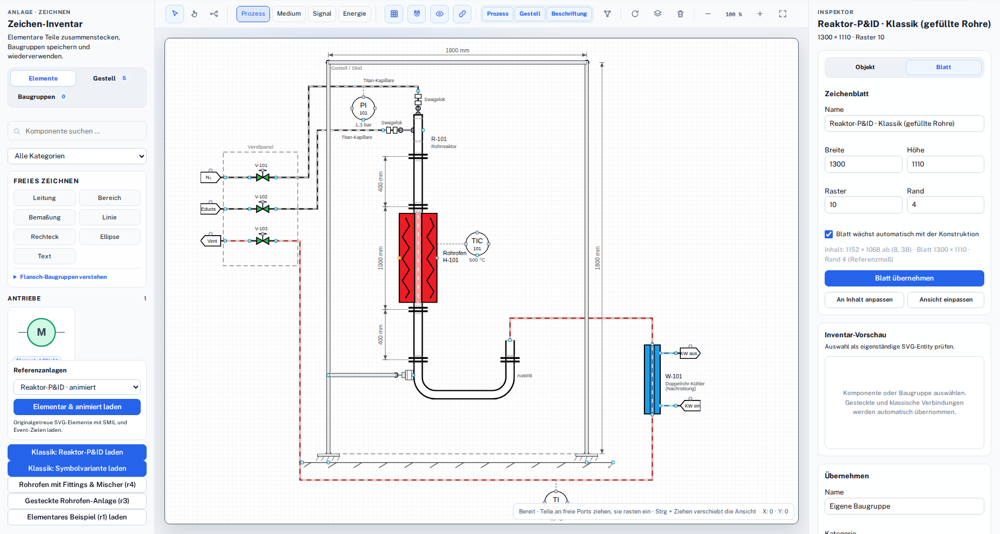
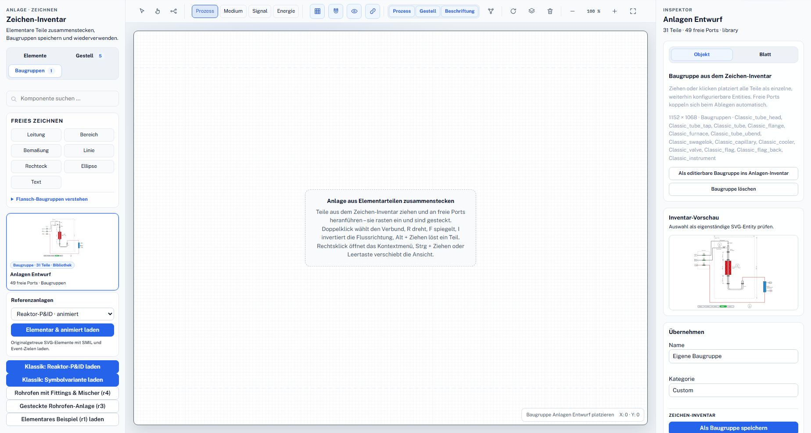
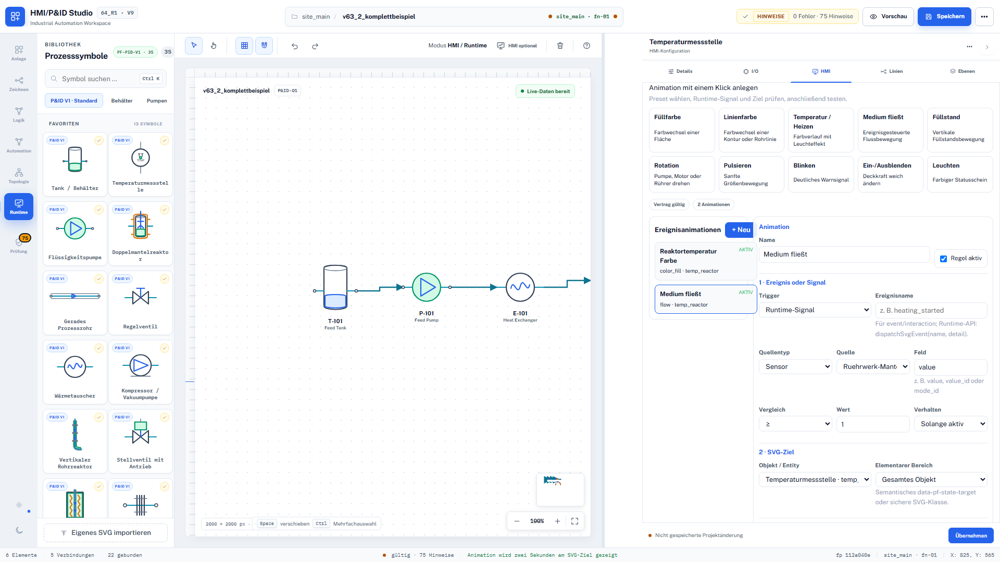
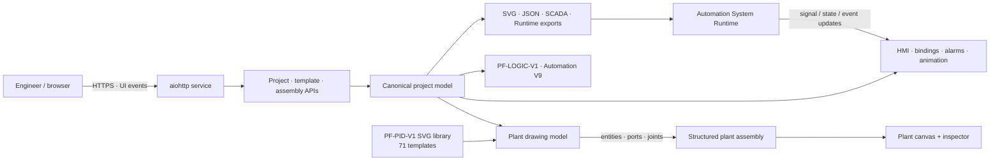

# Plant Factory

<p align="center">
  
</p>

<p align="center">
  <strong>Design process plants from reusable SVG components, bind real automation semantics and carry the result into HMI/SCADA and runtime exports.</strong>
</p>

<p align="center">
  <a href="https://github.com/Centaurus-X/Plant_Factory/actions/workflows/quality.yml"></a>
  <a href="https://github.com/Centaurus-X/Plant_Factory/releases"></a>
  
  
  <a href="LICENSE"></a>
</p>

<p align="center">
  <a href="README.de.md">Deutsch</a> ·
  <a href="#quick-start">Quick start</a> ·
  <a href="docs/ARCHITECTURE.md">Architecture</a> ·
  <a href="docs/v64_r6/TEST_UND_FREIGABE.md">Release evidence</a> ·
  <a href="SECURITY.md">Security</a>
</p>

---

## From drawing to executable plant context

Engineering tools often force a choice between a visually faithful drawing and
a machine-readable automation model. Plant Factory keeps both together. A
drawing assembly can be placed as individually selectable plant entities with
semantic ports, connections, I/O assignments, HMI bindings, states, alarms and
event animations, while dimensions, labels and layout regions remain a passive
visual layer.

Version `64_r6` is the latest additive release in a multi-year engineering
line. It preserves the established PF-PID-V1, PF-LOGIC-V1, Automation V9 and
V8 cross-node contracts while completing the path from the drawing inventory
to structured plant assemblies.

## Who it is for

- Automation and process engineers building P&IDs and interactive plant views.
- HMI/SCADA teams that need SVG graphics with explicit signal and actuator bindings.
- System integrators mapping engineering artifacts to Node V9 and Cross V8 runtime contracts.
- Researchers and tool builders exploring functional, event-driven engineering software.
- Teams that need reusable assemblies without flattening every device into one opaque SVG.

## What you can achieve

- Assemble equipment, pipework, instruments, frames and annotations on one scalable canvas.
- Reuse a drawing as a structured assembly while retaining per-device configuration.
- Add semantic process, medium, signal and energy connections between ports.
- Bind sensors, actuators, HMI widgets, alarms and ten event-animation effects.
- Build typed logic with IEC timers/counters and export runtime or Siemens SCL artifacts.
- Export SVG, JSON, SCADA/HMI and Automation V9-compatible project data from one model.

## Product tour

| Structured engineering | Runtime-ready plant view |
|---|---|
|  |  |
| A 31-entity assembly stays reusable and editable. | Semantic signals drive SVG state and animation. |

More than 70 release-evidence images document light, dark, responsive,
engineering, logic, topology, validation and runtime states in
[`release_evidence/`](release_evidence/).

## Engineering capabilities

| Capability | Operational value | Evidence in this release |
|---|---|---|
| Structured drawing assemblies | Reuse a complete design without losing individual equipment identities. | 31 entities, 14 connections and 45 drawing elements in the bundled assembly. |
| PF-PID-V1 library | Standard and classic plant components carry ports and animation targets. | 71 deterministic templates. |
| Plant drawing editor | Place, snap, connect, resize, rotate, mirror, layer and annotate components. | V64 R3–R6 model, server and browser contracts. |
| HMI/SCADA modeling | Bind widgets, sources, styles, alarms and interactions explicitly. | Project, export and browser regression coverage. |
| Event-driven SVG | Apply fill, stroke, temperature, flow, blink, pulse, rotate, level, opacity and glow effects. | `plant-factory.svg-event-animation` contract. |
| PF-LOGIC-V1 | Build typed functional logic and deterministic execution plans. | 33 logic blocks and JavaScript/Python parity tests. |
| Automation V9 bridge | Keep one canonical automation truth while preserving compatibility. | Node V9 and Cross V8 export contracts. |
| Safe local service | Sanitize SVG, isolate project/template paths and write atomically. | Security and HTTP API regression tests. |

> [!IMPORTANT]
> Plant Factory is an **engineering release**, not an independently certified
> safety system. Generated logic, HMI behavior, I/O mappings and exports must be
> reviewed and validated for the target plant before they can influence real
> equipment.

## Architecture at a glance



The detailed component boundaries, data flow, structured-assembly lifecycle,
security boundary and performance model are documented in
[Architecture](docs/ARCHITECTURE.md). The standalone Mermaid source is
[`plant-factory-components.mmd`](docs/diagrams/plant-factory-components.mmd).

## Quick start

### Requirements

- Linux or another Unix-like environment for the supplied shell workflow.
- Python 3.11+ and `pip`.
- Node.js 20+ for JavaScript contract tests.
- Chromium/Chrome plus Playwright for the complete browser regression suite.

```bash
git clone https://github.com/Centaurus-X/Plant_Factory.git
cd Plant_Factory

python3 -m venv .venv
. .venv/bin/activate
python -m pip install --upgrade pip
python -m pip install -r requirements-dev.txt
npm install

./start_plant_factory.sh
```

Open `http://127.0.0.1:8090/`.

The launcher defaults to `0.0.0.0:8090`. Restrict it with
`PLANT_FACTORY_HOST=127.0.0.1` when remote access is not required. A durable
network deployment requires an authenticated TLS reverse proxy and an
appropriate authorization model.

## Validation and release evidence

Run the complete release gate on Linux:

```bash
./test_all.sh
```

The recorded `64_r6` release evidence includes:

- V64 base contract: `100/100` checks.
- R1–R5 additive contracts: `40/40`, `49/49`, `86/86`, `128/128`, `199/199`.
- R6 model, static release, server and browser contracts: `16/16`, `60/60`, `13/13`, `29/29`.
- Deterministic 71-template symbol library and 33-block logic library.
- Internal SHA-256 manifest for every original release file.
- The original byte-exact ZIP and sidecar attached to the GitHub release.

These are project-maintained engineering records, not independent
certification. See [V64 R6 test and approval](docs/v64_r6/TEST_UND_FREIGABE.md)
and [release notes](RELEASE_NOTES_V64_R6_DE.md).

## Performance model

The browser performs local SVG/model interaction; the Python service handles
static delivery, persistence and bounded project/template APIs. Runtime updates
are event-driven, and reusable libraries are loaded once into the working
model. The release intentionally publishes no universal latency or maximum
diagram-size claim: browser engine, SVG complexity, animation density, project
size and host hardware dominate the result. Qualify representative projects on
the intended workstations and measure interaction time, render time, export
time and memory growth.

## Repository map

```text
public/                     UI, SVG templates, event/HMI/logic modules
config/                     canonical V9, rule, process and library data
projekte/                   example projects and SVG exports
runtime_compat/             runtime compatibility boundary
test/                       Python, JavaScript and browser regression suites
release_evidence/           visual release evidence
docs/v64_r6/                current architecture, manifest and approval record
_tools/                     deterministic builders, migration and validation
svg_editor_tool.py          local service entry point
```

## Known boundaries

- The service does not provide production-grade identity, RBAC or TLS termination by itself.
- The release record does not claim WCAG certification, despite keyboard, focus and forced-color coverage.
- Browser tests qualify specific viewports and workflows, not every browser/device combination.
- Custom SVG is sanitized, but imported content should still be reviewed before use.
- Runtime and controller behavior belongs to the separately deployed Automation System Runtime.
- No quantitative throughput, latency, jitter or maximum-canvas guarantee is made.

## Documentation

- [Architecture and technical diagnosis](docs/ARCHITECTURE.md)
- [V64 R6 architecture and operation](docs/v64_r6/ARCHITEKTUR_UND_BEDIENUNG.md)
- [V64 R6 test and approval](docs/v64_r6/TEST_UND_FREIGABE.md)
- [V64 R6 release manifest](docs/v64_r6/RELEASE_MANIFEST_V64_R6.json)
- [Release notes](RELEASE_NOTES_V64_R6_DE.md)
- [Original release README](docs/ORIGINAL_RELEASE_README_V64_R6_DE.md)

## Security

Do not publish vulnerabilities, credentials, private plant data or controller
addresses in public issues. Follow [SECURITY.md](SECURITY.md) and use GitHub's
private vulnerability reporting.

## Contributing

Read [CONTRIBUTING.md](CONTRIBUTING.md) before opening a pull request. The
functional style is intentional: no classes, decorators, lambdas or JavaScript
arrow functions; use `functools.partial()` or an explicit functional binding.

## License and engineering services

The public project is licensed under [GNU GPL v3.0 only](LICENSE). Separate
commercial licensing or engineering work may be discussed for integration,
custom symbols/adapters, architecture review, deployment and validation; see
[Commercial licensing](COMMERCIAL_LICENSE.md).

---

<p align="center">
  Built over years of iteration — with respect for established engineering
  practice and a clear path from drawing to the automation systems of tomorrow.
</p>
