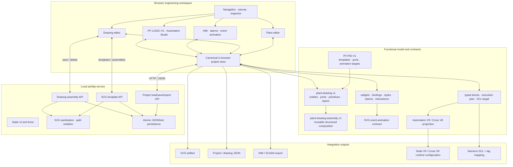
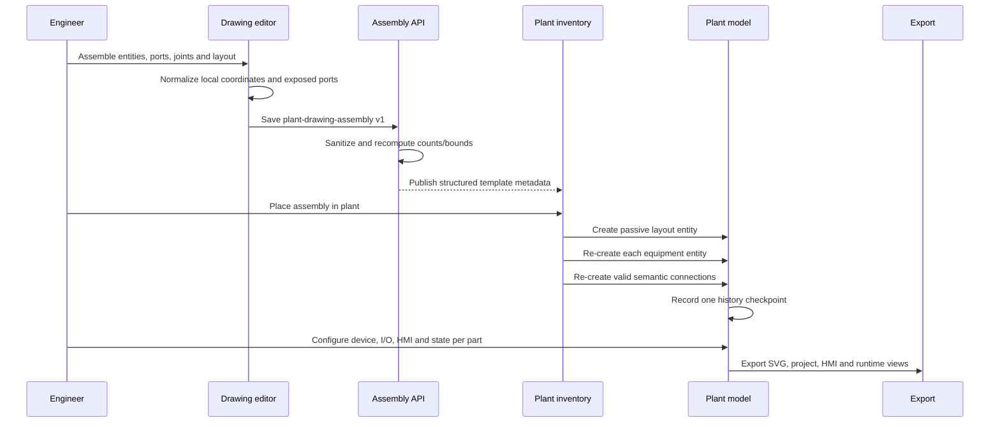

# Plant Factory architecture and technical diagnosis

## Executive assessment

Plant Factory `64_r6` is a functional, browser-based engineering application
served by a small `aiohttp` process. Its strongest architectural property is
the canonical project model: drawing, plant entities, semantic connections,
I/O assignments, HMI configuration, automation sections and exports are views
of one model rather than independent databases.

The R6 addition closes a historically difficult boundary. A drawing assembly
can now become a structured plant template whose devices and connections are
re-created as ordinary plant objects. Passive labels, dimensions and regions
remain in a pointer-transparent layout entity. This prevents the usual loss of
editability caused by flattening an engineering drawing into one SVG object.

## Component architecture

Standalone source: [`diagrams/plant-factory-components.mmd`](diagrams/plant-factory-components.mmd).

## Structured-assembly lifecycle

The server accepts only the known `structured-assembly` composition mode,
normalizes embedded data, recalculates part/connection counts and rejects
dangling connections. Unknown modes fall back to the established flat SVG path.

## State and ownership

| State | Owner | Persistence / projection |
|---|---|---|
| Drawing entities, joints, layers and primitives | Canonical project model | Project JSON and drawing export |
| Plant entities and semantic connections | Plant model | Project JSON, SVG and runtime exports |
| I/O assignments | `project.devices.assignments` | Node/runtime projection |
| HMI widgets and bindings | `project.hmi.hmi_ui` | HMI/SCADA export |
| Process states and rules | Project + canonical V9 sections | Automation V9 bridge |
| Custom templates and assemblies | Local service APIs | Isolated files beneath configured directories |

No second browser storage is used as an automation authority. Exporters derive
their artifacts from the same current project state.

## Event and animation flow

1. A sensor, actuator, process-state, interaction, general event or alarm
   satisfies a normalized trigger.
2. A binding resolves the source and optional condition.
3. The rule targets a plant entity or a semantic `data-pf-state-target` within
   its SVG.
4. The runtime applies a bounded visual effect and preserves the configured
   style/animation contract in the exported HMI payload.

This is visualization behavior. It does not bypass runtime safety or grant the
browser direct authority over hardware.

## Service and security boundary

- Static assets, project APIs and template APIs share the local HTTP service.
- Imported SVG removes scripts, event attributes, `foreignObject`, external
  resources and external CSS URLs.
- File names and project/assembly identifiers are normalized before joining
  storage paths; writes use atomic sibling replacement.
- Server-side assembly normalization does not trust client-provided counts.
- The default package is a local engineering service, not an Internet-facing
  identity provider. Put remote deployments behind authenticated TLS and an
  authorization boundary.

See [SECURITY.md](../SECURITY.md) for reporting and deployment guidance.

## Performance characteristics

The dominant interactive costs are SVG DOM size, number of rendered entities,
animation density, browser layout/paint work and project serialization. The
service is intentionally small and event-driven, but there is no published
universal throughput or latency guarantee.

For target qualification, record at least:

- initial project and template-library load time;
- drag, snap, selection and inspector response at representative entity counts;
- animation frame stability under realistic signal rates;
- save/export duration and resulting artifact size;
- browser and service memory growth during a full engineering session.

Use the supplied large examples and release-evidence workflows as repeatable
fixtures. Publish hardware, browser, viewport, project size and measurement
method with every performance claim.

## Deployment model

The supported packaged workflow is a local Python service started by
`start_plant_factory.sh`. Host and port are controlled through
`PLANT_FACTORY_HOST` and `PLANT_FACTORY_PORT`. For shared deployment:

1. bind the service to a controlled interface;
2. place it behind an authenticated TLS reverse proxy;
3. restrict filesystem permissions and project/template directories;
4. back up project and custom-library data;
5. keep runtime/controller authority in the separately qualified automation runtime;
6. repeat browser, export and integration tests on the target environment.

## Diagnostic conclusion

The codebase demonstrates unusually deep additive compatibility across many
engineering releases. Its most defensible product differentiator is not the
number of SVG symbols alone; it is the preservation of semantic identity from
drawing part to plant entity, HMI binding, logic and runtime export. The main
production gaps are external identity/RBAC/TLS, target-specific performance
qualification and plant-specific safety validation—boundaries that the public
positioning must keep explicit.
